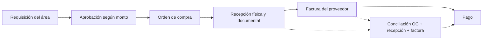

# Quiz #2 — Gestión de Inventarios
## Parte A — Constructora Del Valle S.A.

**Solución:** Opción 2, control de inventario para una empresa de construcción.
**Moneda:** colones costarricenses (₡).

> Los datos de A1, A2, A3 y A5 provienen del enunciado. Las calificaciones de
> proveedores de A4 y las equivalencias técnicas no demostradas se identifican
> expresamente como supuestos académicos.

## A1 — Circuito de compras y matriz de aprobación



| Etapa | Responsable principal | Documento generado | Control clave |
|---|---|---|---|
| Requisición | Responsable de Obras, Mantenimiento o Bodega | Requisición interna | Justificar necesidad, centro de costo, cantidad y fecha requerida |
| Aprobación | Jefatura, Compras, Gerencia Financiera o Gerencia General | Aprobación electrónica o firmada | Validar presupuesto, monto, cotizaciones y ausencia de fraccionamiento |
| Orden de compra | Jefatura de Compras | OC numerada | Proveedor autorizado, precio, plazo, condiciones y aprobador |
| Recepción | Bodega o responsable de obra | Acta/nota de recepción | Comparar cantidad y calidad contra la OC; registrar diferencias |
| Factura | Proveedor y Cuentas por Pagar | Factura electrónica | Validar proveedor, impuestos, OC y recepción |
| Pago | Tesorería | Comprobante de pago | Conciliación de tres vías y autorización según monto |

La conciliación de tres vías compara la orden de compra, la recepción y la
factura. El pago solo debe liberarse si proveedor, material, cantidades, precio,
impuestos y tolerancias coinciden o si existe una excepción aprobada.

### Matriz de aprobación

| Monto | Aprueba | Cotizaciones mínimas |
|---:|---|---:|
| Hasta ₡250 000 | Jefatura del área solicitante | 1 |
| ₡250 001–₡2 000 000 | Jefatura de Compras | 2 |
| ₡2 000 001–₡10 000 000 | Gerencia Financiera | 3 |
| Más de ₡10 000 000 | Gerencia General | 3 + comité |

El fraccionamiento ocurre cuando una compra se divide en varias solicitudes u
órdenes para mantener cada monto debajo de un umbral y evitar una aprobación
superior. Controles preventivos:

1. Consolidar requisiciones del mismo material, proveedor, área y periodo antes
   de calcular el nivel de aprobación.
2. Alertar cuando órdenes cercanas en fecha superen juntas un umbral o repitan
   proveedor y material.
3. Impedir que el solicitante y el aprobador sean la misma persona.
4. Exigir cotizaciones y aprobación por excepción cuando el acumulado mensual
   supere el umbral.
5. Auditar cambios de cantidad, proveedor y división de órdenes.

**Estado:** CUMPLE como diseño académico. **Puntaje estimado:** 8/8, sujeto a
que el curso acepte esta descripción como respuesta de la Parte A.

## A2 — Clasificación de gastos

### Taxonomía de dos niveles

| Nivel 1 | Nivel 2 | Código ejemplo |
|---|---|---|
| Materiales de construcción | Cementantes | `MAT-CEM` |
| Materiales de construcción | Acero y refuerzo | `MAT-ACE` |
| Materiales de construcción | Mampostería y agregados | `MAT-MAM` |
| Materiales de construcción | Tuberías y accesorios | `MAT-TUB` |
| Seguridad ocupacional | Protección de manos | `SEG-MAN` |

### Reclasificación de las ocho líneas

| Línea | Clasificación | Código estándar | Equivalencia |
|---|---|---|---|
| Cemento gris 50 kg | Materiales / Cementantes | `MAT-CEM-GRIS-50` | Igual a `CEM-GRIS-50` si ficha técnica confirma presentación |
| Saco cemento uso general | Materiales / Cementantes | `MAT-CEM-USO-GEN` | Candidato relacionado, no equivalente automático al cemento gris |
| CEM-GRIS-50 | Materiales / Cementantes | `MAT-CEM-GRIS-50` | Equivalente por descripción y presentación |
| Varilla #3 grado 40 | Materiales / Acero y refuerzo | `MAT-ACE-VAR-3-G40` | Referencia exacta del enunciado |
| Hierro 3/8 x 6 m | Materiales / Acero y refuerzo | `MAT-ACE-3-8-6M` | Posible equivalente dimensional; requiere confirmar grado y longitud |
| Guantes de nitrilo talla L | Seguridad / Protección de manos | `SEG-GUA-NIT-L` | No equivalente automático a guante de trabajo |
| Guantes trabajo L | Seguridad / Protección de manos | `SEG-GUA-TRAB-L` | Requiere comparar material y norma de protección |
| Tubo PVC 1/2 SDR 13.5 | Materiales / Tuberías | `MAT-TUB-PVC-12-SDR135` | Referencia técnica específica |

### Ahorro potencial

Para evitar supuestos excesivos, se presentan dos escenarios.

**Cemento gris exacto:** el menor precio observado para `CEM-GRIS-50` es
₡6 300. La línea de 200 unidades a ₡6 450 tendría:

```text
(₡6 450 - ₡6 300) × 200 = ₡30 000
```

La línea de 300 unidades ya está a ₡6 300, por lo que su ahorro es ₡0.

**Escenario ampliado de equivalencia:** si Compras confirma que el saco de uso
general cumple las mismas especificaciones, su ahorro adicional sería:

```text
(₡7 100 - ₡6 300) × 40 = ₡32 000
```

Total conservador: **₡30 000**. Total ampliado condicionado a equivalencia:
**₡62 000**.

**Varilla/acero:** el menor precio observado para la línea comparable es
₡2 150. La línea de hierro de 60 unidades a ₡2 600 representaría:

```text
(₡2 600 - ₡2 150) × 60 = ₡27 000
```

Este ahorro solo es válido si se confirma equivalencia de grado, diámetro y
longitud. La varilla #3 de 500 unidades ya está a ₡2 150.

Negociar por volumen permite consolidar demanda de Obras, Mantenimiento y
Bodega, reducir costos de cotización y transporte, y obtener descuentos. Debe
mantenerse la competencia entre proveedores y evitar dependencia excesiva.

**Estado:** CUMPLE con supuestos técnicos identificados. **Puntaje estimado:**
7/8 hasta validar fichas técnicas y códigos corporativos.

## A3 — Análisis de gasto y fuga de valor

### Compras potencialmente duplicadas

- **OC-1041 y OC-1042:** mismo día, área, proveedor, material, cantidad y
  precio. Es una coincidencia fuerte y debe investigarse; no se declara
  duplicidad confirmada sin requisiciones, recepciones y facturas.
- **OC-1050 y OC-1053:** mismo proveedor y material, fechas separadas por un
  día y cantidades de 500 y 480. También es sospechosa; podría ser una compra
  legítima por fases.

Criterio preventivo propuesto: mismo proveedor, mismo material, cantidades con
diferencia máxima del 10 % y fechas dentro de 7 días. El resultado debe ser una
alerta para revisión humana, no una cancelación automática.

### Sobreprecio por línea

Se utilizan como referencias ₡6 300 para cemento y ₡2 050 para varilla.

| OC | Cálculo | Sobreprecio |
|---|---:|---:|
| OC-1041 | (₡6 450−₡6 300) × 200 | ₡30 000 |
| OC-1042 | (₡6 450−₡6 300) × 200 | ₡30 000 |
| OC-1047 | (₡7 100−₡6 300) × 40 | ₡32 000 |
| OC-1050 | (₡2 150−₡2 050) × 500 | ₡50 000 |
| OC-1053 | (₡2 150−₡2 050) × 480 | ₡48 000 |
| OC-1058 | (₡2 600−₡2 050) × 60 | ₡33 000 |
| OC-1061 | (₡6 300−₡6 300) × 300 | ₡0 |
| **Total** |  | **₡223 000** |

Las líneas fuera de referencia son OC-1041, OC-1042, OC-1047, OC-1050, OC-1053
y OC-1058.

### Fuga mensual y escenario de duplicidad

Escenario base, sin declarar duplicidades confirmadas:

```text
Fuga mensual por sobreprecio = ₡223 000
Proyección anual = ₡223 000 × 12 = ₡2 676 000
```

Si una revisión documental confirma que OC-1042 fue completamente innecesaria,
su costo evitable a precio de referencia sería ₡1 260 000:

```text
200 × ₡6 300 = ₡1 260 000
```

Para no contar dos veces la misma pérdida, se excluyen los ₡30 000 de
sobreprecio de OC-1042 al sumar este escenario:

```text
Sobreprecio de líneas restantes = ₡223 000 − ₡30 000 = ₡193 000
Escenario con duplicidad confirmada = ₡193 000 + ₡1 260 000 = ₡1 453 000/mes
Proyección anual del escenario = ₡17 436 000
```

Este segundo resultado no es una pérdida confirmada; es un escenario sujeto a
validar requisición, recepción, factura y uso real.

Tres controles preventivos:

1. Bloqueo/alerta de duplicados por proveedor, material, cantidad y fecha.
2. Conciliación obligatoria de requisición, OC, recepción y factura.
3. Catálogo único de materiales y consolidación periódica de demanda.

**Estado:** CUMPLE con distinción entre sospecha y confirmación. **Puntaje
estimado:** 10/10 si se aceptan los escenarios y supuestos explicitados.

## A4 — Evaluación ponderada de proveedores

Las calificaciones son supuestos académicos de 1 a 5 porque el enunciado no
proporciona mediciones históricas de proveedores.

| Criterio | Peso |
|---|---:|
| Precio | 25 % |
| Calidad | 20 % |
| Cumplimiento de plazos | 20 % |
| Crédito | 15 % |
| Servicio posventa | 10 % |
| Cobertura geográfica | 5 % |
| Riesgo de dependencia | 5 % |
| **Total** | **100 %** |

| Proveedor | Precio | Calidad | Plazos | Crédito | Posventa | Cobertura | Dependencia | Puntaje / 5 |
|---|---:|---:|---:|---:|---:|---:|---:|---:|
| A | 4 | 4 | 3 | 3 | 4 | 5 | 2 | **3,60** |
| B | 3 | 5 | 4 | 4 | 3 | 4 | 4 | **3,85** |
| C | 5 | 3 | 5 | 2 | 3 | 3 | 5 | **3,85** |

Ejemplo para B:

```text
(4×25 + 5×20 + 4×20 + 4×15 + 3×10 + 4×5 + 4×5) / 100 = 3,85
```

Se recomienda mantener dos proveedores principales, B y C, porque empatan en el
resultado y compensan riesgos distintos: B ofrece mejor calidad y crédito,
mientras C ofrece precio y plazo. A puede mantenerse como respaldo. Consolidar
todo en un solo proveedor reduciría transacciones, pero aumentaría dependencia y
riesgo de interrupción.

**Estado:** CUMPLE como ejercicio ponderado con supuestos explícitos. **Puntaje
estimado:** 7/7.

## A5 — Stock y punto de reorden

Fórmulas:

```text
SS = (demanda máxima diaria − demanda promedio diaria) × tiempo de entrega
PR = demanda promedio diaria × tiempo de entrega + SS
```

| Material | SS | PR | Stock actual | Déficit contra PR | Reposición |
|---|---:|---:|---:|---:|---|
| Cemento | (55−40)×3 = **45** | 40×3+45 = **165** | 190 | 0 | No |
| Varilla #3 | (160−120)×5 = **200** | 120×5+200 = **800** | 850 | 0 | No |
| Block | (900−600)×4 = **1 200** | 600×4+1 200 = **3 600** | 2 800 | 800 | Sí |
| Arena | (10−6)×2 = **8** | 6×2+8 = **20** | 14 | 6 | Sí |

Prioridad propuesta:

1. **Block:** déficit absoluto de 800 unidades y demanda diaria alta; puede
   detener varias actividades de obra.
2. **Arena:** déficit relativo del 30 % respecto al punto de reorden, aunque su
   déficit absoluto es menor.
3. **Varilla #3:** vigilar; tiene margen de 50 unidades sobre el PR.
4. **Cemento:** vigilar; tiene margen de 25 unidades sobre el PR.

La prioridad combina déficit, demanda diaria, impacto operativo y tiempo de
entrega. Las unidades no se suman entre materiales incompatibles.

Datos mínimos para trazabilidad:

- material y cantidad positiva;
- fecha y tipo de movimiento;
- usuario responsable;
- ubicación de origen y/o destino;
- documento de origen;
- orden y detalle de compra cuando corresponda;
- recepción relacionada para entradas recibidas;
- observaciones y referencia de auditoría.

**Estado:** CUMPLE. **Puntaje estimado:** 7/7.

## Resumen de Parte A

| Ejercicio | Máximo | Estimación | Estado |
|---|---:|---:|---|
| A1 | 8 | 8 | CUMPLE |
| A2 | 8 | 7 | CUMPLE CON SUPUESTOS |
| A3 | 10 | 10 | CUMPLE |
| A4 | 7 | 7 | CUMPLE CON SUPUESTOS ACADÉMICOS |
| A5 | 7 | 7 | CUMPLE |
| **Total** | **40** | **39** | **ESTIMACIÓN** |

La estimación no sustituye la calificación docente. Requieren revisión humana:
validar equivalencias técnicas, confirmar datos reales de proveedores y decidir
si la duplicidad de OC-1042 u OC-1053 está documentalmente comprobada.
